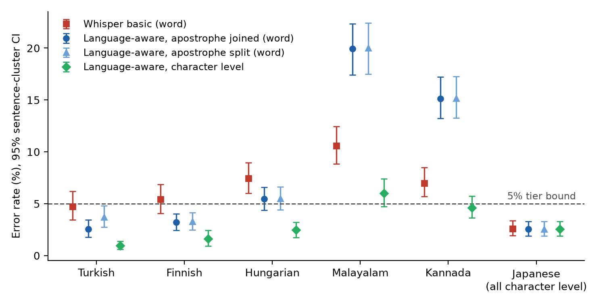

# asr-tier-audit

**"≤ 5% WER" is not one number. On the same transcripts, the text normalizer alone moves Finnish from 3.2% to 5.4% and Malayalam from 20% to 6%.**

This repo turns a published accuracy tier into something you can check, and gives the check that settles it: **minutes of audio to refute a wrong claim, about two hours to certify a right one, with a ≤ 5% error guarantee that holds whenever you stop.**



## What we found

One system (Scribe v2), six languages its vendor lists as "Excellent (≤ 5% WER)", 200 FLEURS test utterances each, 95% sentence-cluster intervals:

| Language | Whisper normalizer | Language-aware | Character level |
|---|---|---|---|
| Turkish | 4.74 [3.43, 6.21] | **2.55** [1.77, 3.46] | 0.98 |
| Finnish | 5.44 [4.07, 6.84] | **3.22** [2.43, 4.04] | 1.61 |
| Hungarian | 7.46 [6.00, 8.95] | **5.47** [4.37, 6.58] | 2.46 |
| Malayalam | 10.58 [8.84, 12.46] | **19.95** [17.41, 22.36] | 6.00 |
| Kannada | 6.99 [5.70, 8.49] | **15.12** [13.22, 17.23] | 4.63 |
| Japanese (characters) | 2.60 | **2.55** [1.90, 3.28] | 2.55 |

In five of six languages the verdict depends on scoring choices the tier does not state. Two causes do most of it: the widely used Whisper normalizer **deletes bracketed words** that speakers read aloud (+0.7 to +2.2 points), and **splits words at combining marks**, which cuts Malayalam and Kannada word error by 9 to 11 points.

## The fix

1. **State the claim fully**: normalizer (or its code), unit (word or character), test set and size.
2. **Audit it** with the anytime-valid tier test in [`certify.py`](src/asr_tier_audit/certify.py): draw utterances in proportion to their length, stop as soon as one of two betting tests decides. In simulation it refuted Malayalam and Kannada after 17 and 27 utterances and certified Turkish, Finnish and Japanese after 477-673, deciding wrongly in at most 4% of audits run exactly at the bound.

The same test applies to blind-preference claims ("preferred by 75% of listeners"). How many votes such shares need is in [`exp4`](results/tables/exp4_preference_claims.csv).

## Run it

```bash
uv sync && uv run pytest -q
uv run python experiments/exp1_normalizer_intervals.py     # every table and figure regenerates offline
```

Paper: [paper/main.pdf](paper/main.pdf) · Transcripts: `results/manifests/` · Data: FLEURS (CC-BY-4.0) · Code: MIT

Vahit FERYAD · [vahit.feryat@gmail.com](mailto:vahit.feryat@gmail.com)
